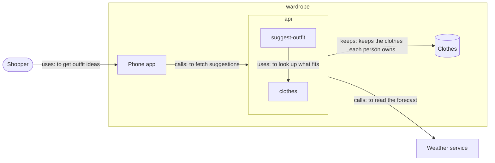

# Sketches

A sketch is a drawing of how a project's software could be: people, software
systems, the containers inside them and the parts inside those, joined by
wires, with notes, lines and frames drawn over them. People draw them in the
app, and so can you, two ways:

- **`draw`** writes a whole sketch at once, as a Mermaid flowchart with a few
  codegraph tags. Drawing again with the same name replaces the sketch, and
  keeps where people moved its cards. Best for a first draft of a big drawing.
- **`edit`** draws one step at a time, the way a person does with the mouse:
  add or change a card, wire two together, give a store its fields, put down a
  note, a line, a frame or a shape, move or take things away, or point at
  something. The person sees your cursor go to each step as you do it. Best
  for changing a sketch, for annotations, and for working with the person.

Ask `looking` what the person has open: the sketch, the level of it they are
on, what their pointer is on, what they have picked, and where each thing on
that level sits. When they say "this", "here" or "that card", ask it first.
Leave the sketch name out of `edit` to draw on the sketch they have open. To
start a new sketch, give `edit` or `draw` a name no sketch has yet.

Read a sketch back with `sketch`. Make a proposal from one with `propose`.

## How to write one



- **A card** is a node: `api["Wardrobe API"]:::server`. The id (`api`) is how
  the rest of the flowchart points at it; the words in brackets are its name;
  any bracket shape will do.
- **Its kind** is the class after `:::`, with dashes for spaces. You can also
  write `class api,web server` on a line of its own. With no class, a card is
  the first kind its level offers.
- **A subgraph is the inside of a card**: `subgraph wardrobe` ... `end` holds
  what is inside the card whose id is `wardrobe`. Give the card its name and
  kind as a node first, or name it on the subgraph: `subgraph wardrobe ["Wardrobe"]`
  with `class wardrobe software-system`.
- **A wire** is an edge, and its words start with its kind:
  `app -->|calls: to fetch suggestions| api`. The kinds are `uses`, `asks`,
  `reads`, `starts`, `keeps`, `leads to`, `calls` and `points at`. A wire with
  no words is a plain `uses`. Words that start with "to" read as what it is for.
- **A wire into a card** from beside it can reach one level in: `shopper --> app`
  draws the wire from the shopper to the wardrobe, and inside the wardrobe on
  to the phone app. To reach deeper, wire to the card the part is in.
- **Notes**: `%% note: words` puts a sticky note on the level it is written
  on. `%% says api: words` says what a card is for. `%% at search: /search`
  gives a page its address.
- **A store's fields**: `%% field people: owner: text, needed, points at teams`
  gives the store `people` a field, one line each: its name, what it holds,
  then `needed` if every record has it and `points at <store>` if it holds
  another record's id. `%% open people: text` makes the store open, saying what
  any field it does not list may hold. With no fields it is fixed and empty.
- Other comments, `classDef`, `style`, `linkStyle` and `direction` lines are
  passed over, so the flowchart can be styled to show elsewhere too.

## The kinds on each level

- **Top level**: `person`, `software-system`, `shallow-software-system` (one
  someone else runs, with no repo here). A person has nothing inside.
- **Inside a software system**, containers: `web-app`, `browser-app`,
  `server`, `desktop-app`, `mobile-app`, `database`, `files-on-disk`,
  `function`, `command-line-tool`, or a plain `card`.
- **Inside a container**, components: `page`, `feature`, `module`, `trigger`,
  or a plain `card`.
- **Inside a database** or files on disk: `store`. Inside a store: `inner-store`.
- **Inside a component**: `file`.
- At the container and component levels, any card type the person has saved
  in the app is a kind too, drawn in its look.

Anything else is turned down. When a line is wrong, nothing is drawn, and
you are told every line that needs fixing.

## Drawing step by step with `edit`

Each step is an object with `do` saying what it is. Cards are named by their
id or their name; annotations by their id or their words. `in` is the card
whose insides the step is on, left out for the top level. Every step is tried
before any is drawn, so a wrong one draws nothing and says which it was.

```json
[
  { "do": "card", "name": "Wardrobe", "kind": "software system" },
  { "do": "card", "name": "Wardrobe API", "kind": "server", "in": "Wardrobe", "id": "api" },
  { "do": "card", "name": "Clothes", "kind": "database", "in": "Wardrobe", "id": "db" },
  { "do": "card", "name": "people", "kind": "store", "in": "db" },
  { "do": "card", "name": "outfits", "kind": "inner store", "in": "people" },
  { "do": "fields", "store": "people", "fields": ["name: text, needed", "team: text, points at teams"] },
  { "do": "wire", "from": "api", "to": "db", "kind": "keeps", "words": "keeps who owns what" },
  { "do": "note", "text": "Offline first?", "near": "api" },
  { "do": "line", "from": "Offline first?", "to": "db", "text": "cache here" },
  { "do": "frame", "text": "Server side", "around": ["api", "db"] },
  { "do": "point", "at": "api", "words": "This is the one to split" }
]
```

- **`card`**: `name`, `kind` (the kinds below, with spaces or dashes), `in`,
  and if you like `id`, `says` (what it is for), `at` (a page's address), `x`
  and `y`. Left without a spot, it goes beside the cards already placed there,
  or the canvas lays it out.
- **`change`**: `what`, then any of `name`, `kind`, `says`, `at`, `x`, `y`
  for a card, or `text`, `color`, `kind`, `x`, `y`, `w`, `h` for an annotation.
- **`remove`**: `what`: a card (with what is inside it and its wires), an
  annotation, or a wire by its id or as `from -> to`.
- **`wire`**: `from`, `to`, `kind` (`uses` if left out) and `words`. It can
  reach one level into a card from beside it, as in a flowchart.
- **`fields`**: `store`, and `fields`, each written like a flowchart field
  above; `open` for what an open store's other fields hold; `unknown: true`
  when its shape is not known. It replaces the fields the store had.
- **`note`**: `text`, `kind` (`sticky` if left out), and either `near` (a card
  it keeps beside) or a spot with `x` and `y`, else it goes in a row above the
  level's cards. `color` is yellow, orange, pink, purple, blue, green or gray.
- **`line`**: `from` and `to`, each a card, an annotation or a spot `{x, y}`,
  on one level; `kind` and `text`.
- **`frame`**: `text` (its name), `around` (the cards it goes round, on one
  level) or a spot with `x`, `y`, `w`, `h`; `kind`. A frame round cards is
  fitted to them when the person next sees that level.
- **`point`**: `at` a card, an annotation or a spot, with `words` beside your
  cursor. Use it to show the person what you mean.

The kinds of annotation:

- **Notes**, which carry words: `text`, `sticky`, `callout`, `list` (one item
  a line), `code`.
- **Lines**, drawn with `line`: `arrow`, `line`, `dashed`, `curve`, `wire`.
- **Frames**, drawn with `frame`: `frame`, `rounded`, `oval`, `lane` (a
  swimlane), `column`, `bracket`, `braces`.
- **Shapes**, drawn with `note`, with the words inside: `rect`, `diamond`,
  `terminator`, `circle`, `hexagon`, `data`, `database`, `document`,
  `documents`, `predefined`, `input`, `stored`, `internal`, `delay`,
  `display`, `manual`, `offpage`, `merge`, `junction`, `or`, `braceleft`,
  `braceright`, `triangle`, `pentagon`, `octagon`, `star`, `cross`, `cloud`,
  `tag`, `chevron`, `right`, `left`, `up`, `down`, `across`, `updown`.

Annotations are notes for people and agents to read. They are not the
architecture: a box drawn as a shape is not a card, and never becomes code.
Draw what should be built as cards and wires.

Places are in the space of the level they are on, with y growing downward;
`looking` says where everything on the level the person is on sits.

## What happens next

The sketch is written on this computer at once, with its cards laid out by the
canvas. If the project is online, the app sends the sketch up the next time it
is open, and anyone on the project sees it then.
